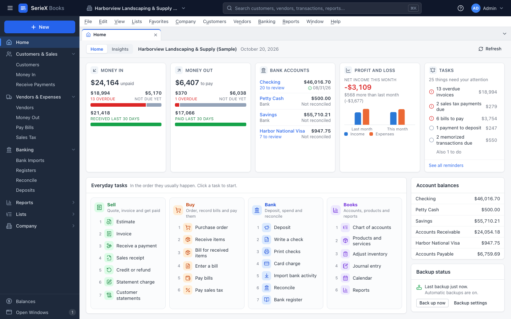
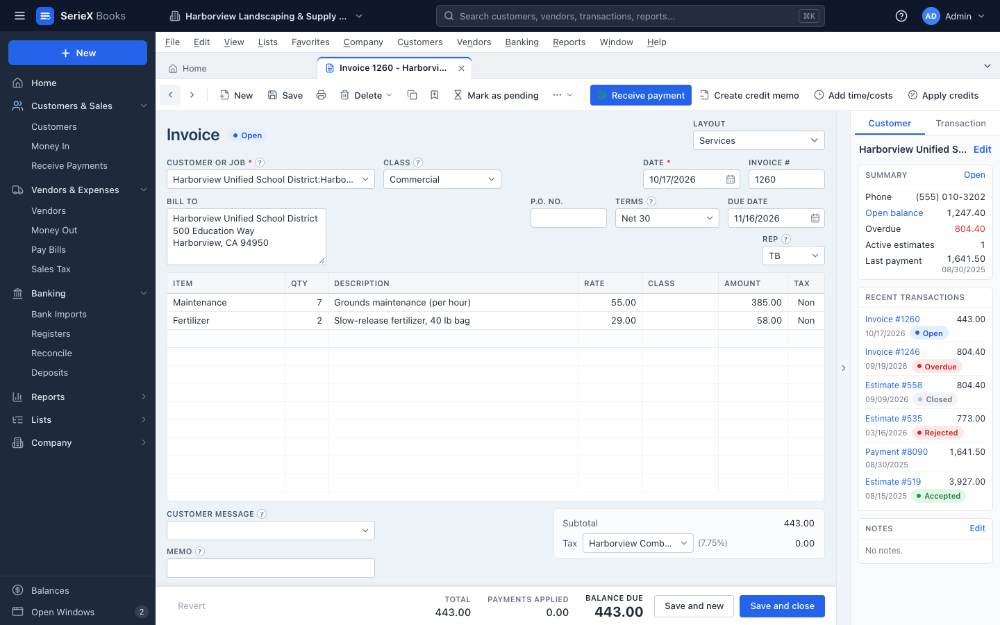
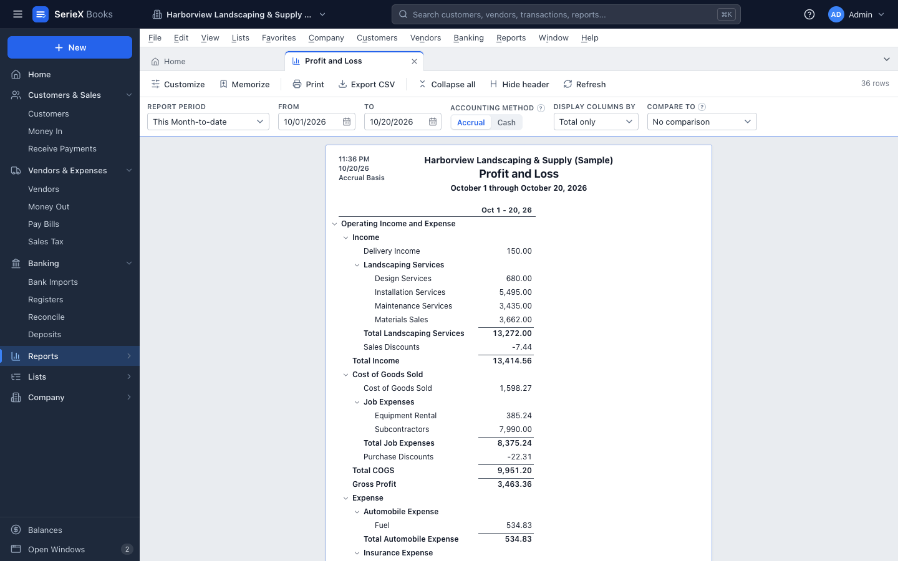

# SerieX

**Free bookkeeping and payroll for small businesses in the United States, on your own computer.**

SerieX is open-source accounting software that you install like any other program. If you have used QuickBooks® Desktop, much of it will feel familiar. Your books are files on your computer, not space rented on someone else's server. There is no account, no subscription and no monthly fee.

[Install](#install) · [Why SerieX](#why-seriex) · [What it does](#what-it-does) · [Screenshots](#screenshots) · [Help](#help)

## Install

SerieX runs on macOS 13 (Ventura) or later, and on Windows 10 or 11 (64-bit). You do not need an administrator password.

### Mac

1. Open **Terminal**, the Mac app where you can type commands. It is in **Applications > Utilities**.
2. Paste this line and press **Return**:

```bash
curl -fsSL https://github.com/CapitalFee/SerieX/releases/latest/download/install.sh | bash
```

### Windows

1. Click **Start**, type `PowerShell` and press **Enter**. A window opens where you can type commands.
2. Paste this line and press **Enter**:

```powershell
irm https://github.com/CapitalFee/SerieX/releases/latest/download/install.ps1 | iex
```

SerieX opens when the install is done. The command downloads the latest release of SerieX, checks that the download is complete and undamaged, and installs it. It also removes the mark your computer puts on files downloaded from the internet, so you do not see the usual warning. Only run it if you trust this project. [What the install command does](docs/user-guide.md#what-the-install-command-does) has the details.

**To update,** run the same command again. It closes SerieX, so save your work first. Your company files are kept.

### Prefer a download?

The command above is the easiest way. If you would rather use an installer file, get the one for your computer from the [latest release](https://github.com/CapitalFee/SerieX/releases/latest):

| Your computer | File |
|---|---|
| Mac with Apple silicon (M1 or later) | [`SerieX-mac-arm64.dmg`](https://github.com/CapitalFee/SerieX/releases/latest/download/SerieX-mac-arm64.dmg) |
| Mac with an Intel processor | [`SerieX-mac-x64.dmg`](https://github.com/CapitalFee/SerieX/releases/latest/download/SerieX-mac-x64.dmg) |
| Windows, 64-bit | [`SerieX-Setup-x64.exe`](https://github.com/CapitalFee/SerieX/releases/latest/download/SerieX-Setup-x64.exe) |

**Not sure which Mac you have?** Open the Apple menu and choose **About This Mac**. "Chip: Apple M…" means Apple silicon. "Processor: … Intel …" means an Intel Mac.

These files are not signed with a developer certificate, which is how your computer learns who made an app. Because of that, your computer warns you the first time you open SerieX. You only need to get past it once:

- **Mac:** open the `.dmg` file and drag SerieX to **Applications**. In **Applications**, right-click (or Control-click) SerieX, choose **Open**, then click **Open** again. If your Mac only offers **Done** or **Move to Trash**, click **Done**, open **System Settings > Privacy & Security** and click **Open Anyway** next to SerieX.
- **Windows:** run the file. When the blue "Windows protected your PC" window appears, click **More info**, then **Run anyway**.

To update, download the new file and install it the same way.

### First start

1. Open **SerieX**. The first time, SerieX Books (the bookkeeping app) opens. After that, SerieX opens the app you used last.
2. Choose **Create a new company** and answer a few questions, or choose **Explore the sample company** to try everything with made-up data first.
3. To switch between bookkeeping and payroll, click the **apps** button (the square of nine dots at the top left). The same company stays open.

## Why SerieX

Most small business owners never set out to become accountants. They want invoices out the door, bills paid on time, paychecks done right, and numbers they can trust at tax time. Many of them want to keep doing that the way they always have: in a program on their own computer, with their books in a file they control.

SerieX is made for them.

**It feels familiar.** If you have kept books in QuickBooks® Desktop or other desktop accounting software, most of what you know carries over. SerieX is built around the same everyday bookkeeping ideas: a chart of accounts, customers and vendors, invoices and bills, checks and deposits, account registers, bank reconciliation, a closing date, and reports you can click into. Where things can be simpler, SerieX makes them simpler, with a guided setup, one search box for everything and messages in plain words.

**Your books can come with you.** SerieX imports the lists and reports that QuickBooks® Desktop exports, so you can start with your balances on a date you choose. It can also bring over every transaction from an IIF file made with an export tool or by your accountant. A test run lists the problems it finds before anything is saved. Afterwards, a report compares your new trial balance with the original files, so you can check that the numbers match.

**Bookkeeping and payroll together.** SerieX Payroll works out paychecks with federal and state tax tables for 2025 and 2026, prepares federal Forms 941, 940, W-2 and W-3, and records every paycheck in your books for you.

**Your data stays yours.** SerieX keeps your books on your computer and does not send them anywhere, unless you choose to connect an AI assistant. It works without an internet connection, has no ads and no tracking, and backs up your bookkeeping for you.

**Careful with your numbers.** Every transaction is recorded with debits and credits that balance. A closing date protects finished periods, an audit trail shows who changed what, and a built-in check finds and repairs problems in a company file.

**Free and open source.** SerieX is licensed under the GNU Affero General Public License, so its code is public and anyone can read and check what it does. It costs nothing, and there is nothing to renew.

SerieX was written from scratch by its contributors. It contains no code from QuickBooks® or any other Intuit product, and it was not made by decompiling or reverse-engineering Intuit software. SerieX is not affiliated with, endorsed by or sponsored by Intuit Inc.

## What it does

### SerieX Books

- **Setup:** a short guided setup suggests a chart of accounts for your kind of business, such as retail, construction, consulting, restaurant, nonprofit, manufacturing or services. You can keep several company files, and a sample company with 18 months of activity lets you practice.
- **Customers and sales:** customers and jobs, estimates, invoices, sales receipts, statement charges and statements, payments with discounts and credits, credit memos and refunds, and billable costs added to invoices. You can print invoices, estimates, sales receipts, credit memos and statements.
- **Vendors and purchases:** purchase orders, receiving items, bills, bill payments with discounts and credits, vendor credits, and 1099 reports.
- **Banking:** checks you can print, deposits, transfers, credit card charges and credits, registers with running balances, and reconciliation. Import activity from files you download from your bank's website (`.ofx`, `.qfx`, `.qbo` or `.csv`), match it to what you already entered, and let bank rules sort repeating transactions. SerieX suggests rules from your history. It never connects to your bank itself.
- **Inventory:** items tracked at average cost, quantity and value adjustments, stock status, valuation and a physical count worksheet.
- **Sales tax:** tax items and combined rates (for example state plus county), liability reports and tax payments.
- **Organize and plan:** journal entries, classes for locations or departments, budgets with budget versus actual, memorized and scheduled transactions, reminders, a to-do list and a calendar.
- **Reports:** about 80 reports, including profit and loss, balance sheet, cash flows, trial balance, general ledger, customer and vendor aging, sales, purchases, inventory, sales tax and the audit trail. Click any amount to see the transactions behind it. Choose accrual or cash basis, compare periods, pick your own columns and filters, save report settings, print, and export to spreadsheets.
- **Control:** users with passwords, a closing date, an audit trail, a company file check and repair, and automatic and manual backups.
- **Moving data:** import and export lists as CSV files, which open in any spreadsheet program, and bring your books over from QuickBooks® Desktop. [How the import works](docs/user-guide.md#import-from-quickbooks-desktop)

### SerieX Payroll

For employers in the United States.

- Pay schedules (for example weekly, every two weeks, twice a month or monthly), plus one-off and final paychecks.
- Hourly pay, salary, overtime, bonuses, commissions, tips and reimbursements.
- Deductions before and after tax, such as 401(k), Roth 401(k), health insurance and health savings accounts, plus company contributions and matching, with yearly limits.
- Tax tables for 2025 and 2026: federal income tax withholding for both the old and the new Form W-4, Social Security, Medicare and federal unemployment, plus state income tax, unemployment, and disability or paid-leave programs for all 50 states and Washington, DC. Local taxes can be added.
- Sick and vacation hours.
- Every paycheck, tax payment and adjustment is recorded in SerieX Books, with a check that payroll and the books agree.
- Tax due dates and payments, Forms 941, 940, W-2 and W-3, the electronic W-2 file for the Social Security Administration, and a quarterly state wage summary.
- Printed paychecks and pay stubs, payroll reports, and a mid-year start with year-to-date amounts.

SerieX Payroll does not move money. It records direct deposit details, but it does not send the deposits, and it does not file or pay taxes for you. Its tax tables cover 2025 and 2026 and need an update for each new year. They were compiled from official government publications and can contain mistakes, so check your state's rates in **Employees > Tax Tables** before your first payroll.

### Also included

- **One desktop app** for both, which works without an internet connection.
- **AI assistants (optional):** let an AI assistant app on your computer, such as the Claude or ChatGPT desktop app, read your books and answer questions like "Which customers are overdue?". It stays off until a SerieX administrator turns it on under **AI Assistants** in the left sidebar, and it can only look unless that administrator also allows changes. [More about AI assistants](docs/user-guide.md#ai-assistants). A free skill also teaches assistants how to work in SerieX: [install the SerieX skill](docs/user-guide.md#use-the-seriex-skill).

> SerieX is bookkeeping and payroll software, not tax, legal or accounting advice. Check your numbers and forms, and ask an accountant or tax professional when in doubt.

## Screenshots

SerieX Books with the sample company.

**The home screen**, with income and expenses at a glance:



**An invoice**, with the customer's balance and recent transactions on the side:



**A profit and loss report**, on accrual or cash basis:



## Help

- **[User guide](docs/user-guide.md):** where your company files are, backups, updating and removing SerieX, the QuickBooks® Desktop import, AI assistants, and what to do if something goes wrong.
- **[Privacy and legal](docs/privacy-and-legal.md):** what SerieX keeps on your computer, what it never sends, the license in plain words, and trademarks.
- **Something not working?** [Open an issue](https://github.com/CapitalFee/SerieX/issues) and say what you did and what you saw.
- **Found a security problem?** Please report it privately, as described in [SECURITY.md](SECURITY.md).
- **Developers:** [run SerieX from source, build the installers and find your way around the code](docs/development.md).

## License

SerieX is free software under the GNU Affero General Public License, version 3 or later. The full text is in [LICENSE](LICENSE), and [Privacy and legal](docs/privacy-and-legal.md#the-license-in-plain-words) explains it in plain words.

QuickBooks is a registered trademark of Intuit Inc. SerieX is an independent project and is not affiliated with, endorsed by or sponsored by Intuit Inc. Other trademarks are listed in [Privacy and legal](docs/privacy-and-legal.md#trademarks).
